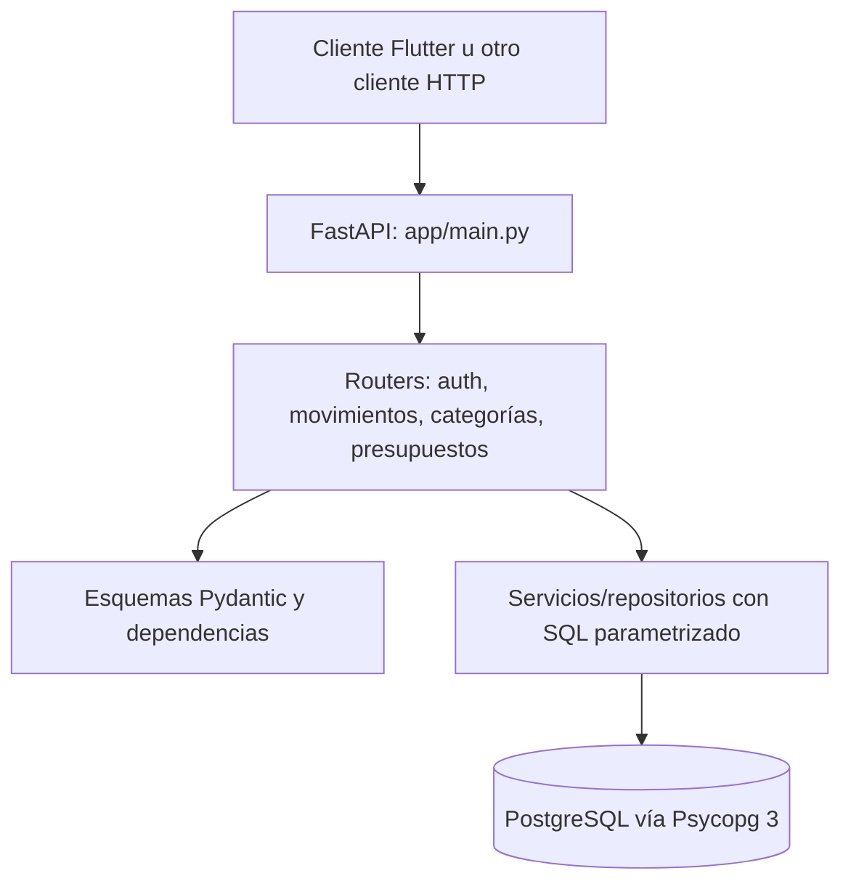

# Arquitectura

## Componentes

`app/main.py` crea `FastAPI(title="FINGO API")`, carga dotenv e incluye routers de movimientos, auth, categorías y presupuestos. La ruta raíz `GET /` devuelve `{"message":"FINGO API funcionando"}`. FastAPI publica el esquema OpenAPI en sus rutas predeterminadas (`/openapi.json`, `/docs`, `/redoc`); no hay configuración que las cambie.

## Módulos y responsabilidades

- `auth/routes.py`: registro (`201`) y login; traduce duplicidad de correo y credenciales no válidas a errores HTTP.
- `auth/service.py`: inserta/consulta usuarios y verifica contraseñas. Guarda un hash, no la contraseña original.
- `auth/security.py`: firma/verifica JWT HS256 con `sub`, `iat`, `exp`; validez de acceso de 30 minutos.
- `auth/dependencies.py`: extrae `Authorization: Bearer ...`, valida token y entrega el ID de usuario a las rutas protegidas.
- `movements/routes.py`, `schemas.py`, `repository.py`: validan, filtran y realizan CRUD de movimientos; cada consulta/escritura está limitada al usuario autenticado.
- `categories/*`: lista categorías predeterminadas visibles y personales, permite crear, renombrar y desactivar las personales.
- `budgets/*`: CRUD de presupuestos de gastos, calcula gasto acumulado, saldo, porcentaje y estado al consultar.
- `database/connection.py`: abre una conexión por operación usando variables `DB_*`; no hay pool ni ORM visible.

## Flujo de solicitud

1. Uvicorn recibe HTTP y FastAPI elige la ruta.
2. Pydantic valida cuerpo y parámetros. Para rutas protegidas, `obtener_usuario_actual` verifica JWT.
3. La ruta aplica reglas de dominio y llama al servicio/repositorio.
4. Psycopg ejecuta SQL parametrizado contra PostgreSQL. Las operaciones de escritura confirman o revierten transacciones según el módulo.
5. FastAPI serializa el resultado JSON y aplica el `response_model` cuando está declarado.

Las consultas de movimientos y categorías retornan filas `fetchall()`/`fetchone()` sin un modelo de respuesta explícito; en Psycopg sus filas se representan como arreglos JSON posicionales, no como objetos con nombres de campo. La respuesta de presupuestos sí usa `BudgetResponse` y es un objeto JSON.

## Límites observables

No hay capa de migraciones, configuración CORS, pool de conexiones, endpoint de salud separado, refresh token, cierre de sesión con revocación, tests ni despliegue definido en los archivos inspeccionados. No se debe asumir que existen en el entorno de producción.
