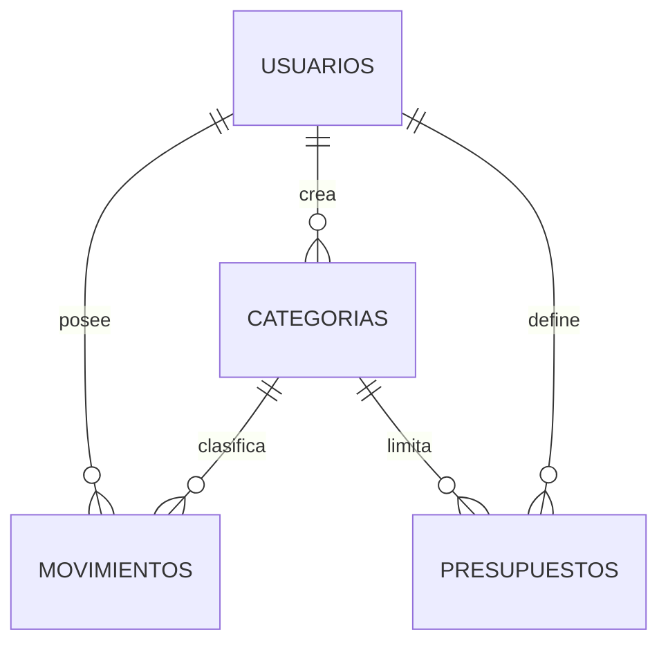

# Base de datos

## Alcance de la evidencia

No hay scripts SQL, migraciones ni modelos ORM en el repositorio. Los nombres y columnas siguientes se infieren directamente de los `SELECT`, `INSERT`, `UPDATE` y `DELETE` de los repositorios. No es posible confirmar tipos exactos, nulabilidad, claves primarias/foráneas físicas, `CHECK`, índices, triggers, extensiones ni reglas `ON DELETE` sin consultar el servidor o su DDL.

## Tablas esperadas

| Tabla | Columnas usadas por la API | Uso |
|---|---|---|
| `usuarios` | `id`, `nombre`, `correo`, `fecha_nacimiento`, `password_hash` | Registro y autenticación. El correo se inserta en minúsculas y se compara sin distinguir mayúsculas. |
| `categorias` | `id`, `nombre`, `tipo`, `usuario_id`, `es_predeterminada`, `activa` | Categorías compartidas (`usuario_id IS NULL`) y personales. Los tipos aceptados por API son `ingreso` y `gasto`. |
| `movimientos` | `id`, `tipo`, `monto`, `categoria_id`, `descripcion`, `fecha`, `usuario_id` | Ingresos y gastos de usuarios; lecturas incluyen nombre de categoría mediante `JOIN`. |
| `presupuestos` | `id`, `usuario_id`, `categoria_id`, `tipo_periodo`, `fecha_inicio`, `fecha_fin`, `monto_limite`, `fecha_creacion` | Límites asociados a una categoría de gasto y período. |

## Relaciones usadas por consultas

El diagrama representa relaciones lógicas que el código usa, no certifica constraints físicos. Categorías predeterminadas usan `usuario_id IS NULL`; el código permite leerlas junto a las del usuario.

## Restricciones y comportamiento comprobables en la aplicación

- Registro detecta una violación `UNIQUE` y la convierte en `409`; no se identifica en el repositorio la definición de índice/constraint que la produce.
- Crear categoría detecta `UniqueViolation` y responde `409` por duplicado nombre/tipo. El alcance exacto y sensibilidad a mayúsculas dependen del constraint SQL no disponible.
- Crear/actualizar presupuesto captura `ExclusionViolation` por períodos superpuestos. El constraint de exclusión debe existir en el esquema desplegado para garantizarlo; su definición no está incluida.
- Categorías personales se desactivan con `activa = FALSE`, preservando historial según la intención del código.
- Monto de movimiento y presupuesto se valida como decimal positivo, hasta 12 dígitos y 2 decimales en las entradas.
- El repositorio aplica pertenencia a usuario en operaciones de movimientos/presupuestos; categorías compartidas o propias pueden seleccionarse si están activas y coinciden con el tipo.

## Índices

No hay declaraciones de índices en el repositorio. No se pueden afirmar índices ni claves únicas físicas; para consultas frecuentes conviene que el DBA contraste el DDL real, en especial filtros por usuario/fecha, relaciones por categoría, correo sin distinción de mayúsculas y regla de exclusión de períodos.

## Verificación recomendada en una instancia existente

Consultar el catálogo PostgreSQL (`\d+ usuarios`, `\d+ categorias`, `\d+ movimientos`, `\d+ presupuestos`, o `pg_catalog`) en un entorno autorizado y actualizar esta referencia con tipos, constraints e índices reales. Esta documentación no sustituye una migración ni propone ejecutar cambios de esquema.
